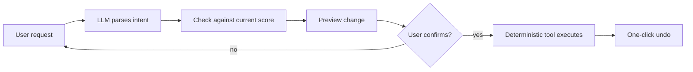

<h1 align="center">Zhuoheng (Felix) Li</h1>

  <b>Product Manager · AI Products · 0→1 Builder</b> 
  M.S. Management & Analytics @ NYU · New York 
  产品经理 / AI 产品 · 从 0 到 1 独立做产品 · 现居纽约

  
  
  
  

  <picture>
    <source media="(prefers-color-scheme: dark)" srcset="https://streak-stats.demolab.com?user=Zhuohengli03&hide_border=true&theme=dark"/>
    
  </picture>

  <picture>
    <source media="(prefers-color-scheme: dark)" srcset="https://raw.githubusercontent.com/Zhuohengli03/Zhuohengli03/output/github-snake-dark.svg"/>
    
  </picture>

---

### About me

- I build products end to end: talk to users, write the spec, ship it with AI-assisted coding, then read the data and decide what to fix next.
- M.S. in Management & Analytics (STEM) at NYU, graduating **Jan 2027**. Open to full-time **PM / AI PM** roles (NYC and SF preferred, open to anywhere in the US).
- B.A. in Music Performance before that, which is how I ended up building software for musicians.
- Interested in AI agents, evals, human-in-the-loop design, and turning messy domain content into structured data.

### Featured project: [Lingxian](https://lingxian.app)

A notation-editing SaaS for the guqin, a traditional Chinese string instrument. Teachers and students were sharing scores through hand copies and phone photos; I defined, built and launched a structured score editor with cloud sync and PDF export. Solo, from zero, currently in invite-only beta.

| | |
|---|---|
| **Traction** | 94 users created 160 scores and exported 144 PDFs in 7 months; 20.7% week-2 retention |
| **Activation** | Built a 5-step funnel, found that 53% of creators never produced a usable score, shipped faster input with live preview; that drop-off fell to 35% |
| **Auto-transcription** | A rule engine generates valid options and beam search picks the best full-piece sequence; users can override, and ~3,800 corrections have been logged as ranking-model training data |
| **AI editing agent** | Natural-language assistant inside the editor. 74-case eval set, prompt iterations v1.0 → v1.4, **96% intent accuracy, 100% valid JSON, zero high-risk false triggers** |

How the agent avoids bad edits: the LLM only understands the request; deterministic tools do every calculation and write.

### Toolbox

**Product:** user research · PRDs · MVP scoping · funnel & event-tracking design · prioritization 
**AI product:** agent task design · prompt iteration · eval sets · human-in-the-loop · preference data

  
  
  
  
  
  
  
  
  
  
  
  

### Off the clock

1,500+ hours in *Squad*, currently deep into *Wardogs* · board games · photography · trying every new AI agent tool I can get my hands on.

---

  

